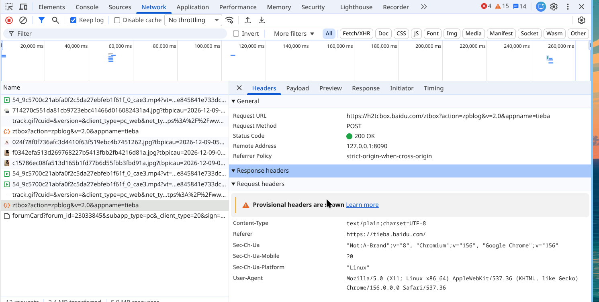
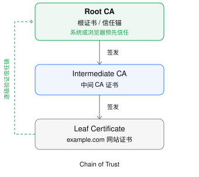
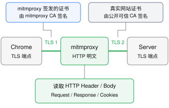
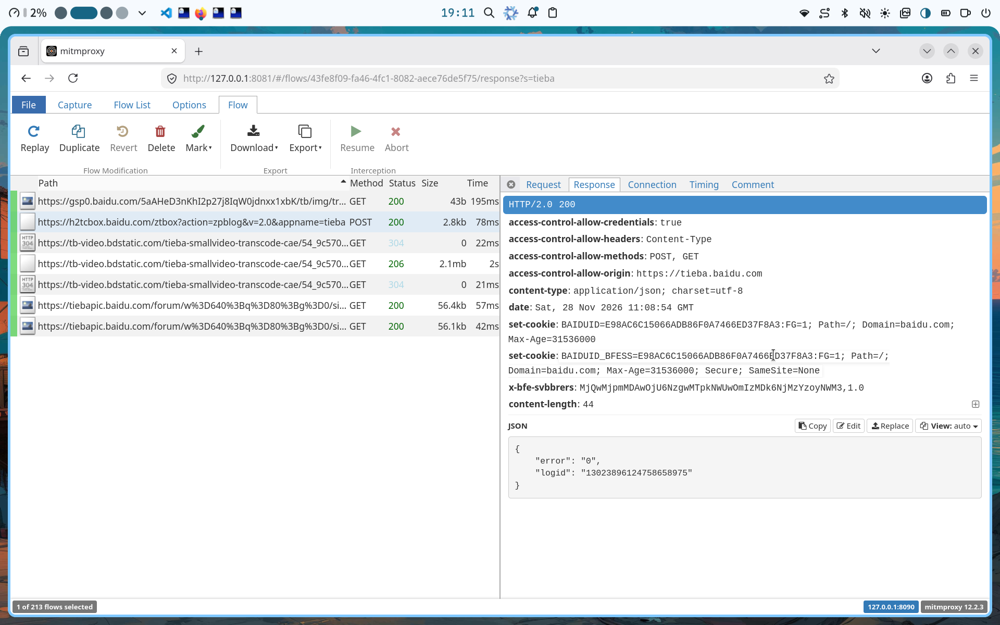

### Stage1: cookie恢复机制初探

最近在逆向百度贴吧的网页时，发现在进行一次人机验证后，再次登录的时候就不需要了，这个数据是存放在哪里的？

首先判断是不是远程存储了信任的机器，用一个新的incognito window访问，还是有人机验证. 猜测这个受信任的标志存放在b
本地的某个变量中.

然后分别尝试删除devtools -> application中的local and session storage, cookies等内容，可以发现在删掉cookie后，快速重新访问当前网页，会再次弹出人机验证. 但如果再等一会儿，cookies中的`BAIDUID`和`BAIDUID_BFESS`会重新恢复，然后再重新加载，就不需要人机验证了.

那么这两个和人机验证有关的cookie变量是怎么设置的呢？

我们查看cookie中变量的属性，发现"http only"的标记没有勾选，意味着它是可以通过前端直接设置的(比如`document.cookie`)

对几种常见的api做了hook:

```js
(() => {
    const target = "BAIDUID";

    const descriptor = Object.getOwnPropertyDescriptor(
        Document.prototype,
        "cookie"
    );

    Object.defineProperty(Document.prototype, "cookie", {
        ...descriptor,

        set(value) {
            if (value.split("=")[0].trim() === target) {
                console.log("[Cookie Write]", value);
                console.trace();
                debugger;
            }

            return descriptor.set.call(this, value);
        }
    });

    console.log("Cookie hook installed:", target);
})();
```

```js
(() => {
    const target = "BAIDUID";

    if (!window.cookieStore) {
        console.log("Cookie Store API unavailable");
        return;
    }

    const original = CookieStore.prototype.set;

    CookieStore.prototype.set = function (...args) {
        const name = typeof args[0] === "string"
            ? args[0]
            : args[0]?.name;

        if (name === target) {
            console.log("[CookieStore Write]", args);
            console.trace();
            debugger;
        }

        return original.apply(this, args);
    };
})();
```

然而都没有触发.

接着将network中的"no throttling"改成offline, 再重复操作，发现cookie不会恢复，那么很可能cookie是通过http包触发写入的.

> **Network页面一些常用选项**
>
> 1. Keep log
> 
> 勾选后，在网页刷新、跳转或导航到其他页面时，保留之前的 Network 网络请求记录
>
> 2. No throttling
>
> 不进行网络限制. 如果改成offline，将切断联网的包，只允许离线脚本.
{: .prompt-tip }

但是经过一些过滤后，我认为最可疑的一个包并没有response header和response body.




### Stage2: 理解ORB机制

让codex + chrome dev tools mcp玩了一会儿，它告诉我这是chrome的ORB机制：

```
200 OK 说明 Chrome 已收到 HTTP 响应。结合这条请求的特征，最符合现有证据的解释是 Chrome 的 ORB/CORB 把交给渲染层的响应清空了。

本次记录里，这条请求具有：

请求：跨源 Beacon，Sec-Fetch-Mode: no-cors
响应：Content-Type: application/json

tieba.baidu.com 和 h2tcbox.baidu.com 属于同站跨源。Chrome 的 ORB/CORB 会检查这类响应；源码中的处理路径可以清空响应头、替换为空正文，同时保留 HTTP 状态码。Chromium 实现、机制说明

这与我抓到的两份记录吻合：

| 观察位置                                 | 结果                               |
| ---------------------------------------- | ---------------------------------- |
| 普通 Network.responseReceived            | 200，headers: {}                   |
| 网络层 Network.responseReceivedExtraInfo | 200，完整原始响应头，含 Set-Cookie |

所以，响应头没有显示出来，仍可能已经被浏览器网络层用于设置 Cookie。本次原始记录 (/tmp/baidu-cookie-investigation/beacon-capture.json)

我之前只解释“sendBeacon 没有响应回调”不够准确：那只能解释页面 JS 拿不到响应，不能直接解释 Network 面板里的响应头空白。

不过，ORB 是根据现有记录和源码作出的判断，尚未直接验证你那次请求；标准 DevTools 也会尝试合并额外响应信息。要确定你那次为什么没显示，需要监听同一请求的 Network.responseReceivedExtraInfo，按 requestId 对照，不能仅凭 200 OK 就完全定因。
```

如何关闭ORB? 为什么要设计ORB?

```
可以用独立的 Chrome 调试实例关闭 ORB。你本机可以这样启动：

google-chrome-stable \
  --user-data-dir=/tmp/chrome-orb-debug \
  --disable-web-security \
  'https://tieba.baidu.com/f?kw=linux'

Chromium 源码明确规定，--disable-web-security 会关闭 ORB。源码依据

随后打开 Network，重新触发 ztbox 请求，比较响应头是否出现。这可以作为验证 ORB 原因的对照实验；若仍然没有响应头，就需要继续检查其他原因。这个参数同时关闭其他网页安全检查，只用于临时配置中的调试。

如果只是查看原始响应头，可以保留安全机制，使用 Chrome 内置的 Protocol Monitor：

1. DevTools → F1 → Experiments → 启用 Protocol Monitor，按提示重新加载 DevTools。
2. Ctrl+Shift+P → Show Protocol monitor。
3. 重新触发请求，找到 Network.responseReceivedExtraInfo，按 requestId 对应到 ztbox，查看 headers。官方操作说明

他们设计清理机制，是为了阻止敏感的跨源数据进入网页所在的渲染进程。

例如，恶意网页可以把另一个网站的账户接口当作图片加载。虽然普通 JavaScript 无权读取其 JSON，但如果原始数据已经进入渲染进程，攻击者仍可能利用 Spectre 或渲染进程漏洞读取内存。ORB/CORB 会提前阻止这类数据传入。Chromium 设计说明

因此，清理针对的是传给渲染层的响应。网络层仍能收到原始响应头、处理 Cookie，这也解释了“Cookie 出现了，但普通记录里的响应头是空的”为何可以同时发生
```

被ORB拦截，是否意味着包就彻底没用了？

```
ORB 拦截响应，并不意味着整个 HTTP 响应的所有副作用都会被撤销。

特别是 Set-Cookie，即使响应最终被 ORB 拦截，其中的 Cookie 仍然有可能被浏览器保存。

这是因为 Cookie 的处理发生在浏览器网络层，而 ORB 主要负责阻止不透明响应的数据被交付给渲染进程。
```

到这里，这个谜题已经解决了一半了. 既然chrome默认的ORB会丢掉最关键的这个包，接下来让我们换一个工具验证.


### Stage3: 理解https中的证书 + 使用mitmproxy

mitmproxy全称"Man in the middle proxy", 是和burpsuite类似的代理工具.

安装后，包含GUI版本`mitmweb`，TUI版本`mitmproxy`，和多用于脚本分析的`mitmdump`.

我们可以用下列方式启用GUI版本：

```
mitmweb --listen-host 127.0.0.1 --listen-port 8090 --web-port 8081
```

`web-port`是管理页面的端口，`listen-port`是开放的代理端口.

接着用chrome的`FoxyProxy`插件来添加并应用一个proxy(保持端口和上面的`listen-port`一致).

然而接着在浏览器中访问网页，会发现弹出“not private”的警告，并无法继续访问. 

这是因为我们还没有在chrome中添加mitmproxy的信任证书. 

众所周知，https相比http，解决了“机密性”，“完整性”，“身份认证”

机密性通过对称加密实现，完整性通过AEAD等完整性保护技术实现，而身分认证就是通过数字证书实现的.

当A和B (example.com)通信的时候，如果B返回给A的数据被中间人C篡改了，而A却当成B的数据去使用，就形成了“中间人攻击”. 

需要有一种机制来证明，数据真的来源于`example.com`，而确认这件事的人应该属于一个可信的第三方，也就是CA(Certificate Authority). 

假设CA和目标网站分别有自己的公私钥:

```
CA:
    CA_Private_Key
    CA_Public_Key

Server:
    Server_Private_Key
    Server_Public_Key
```

服务器将自己的域名和公钥提供给CA，而CA由自己的私钥签发证书.

> 一个证书的字段包括：
> 
> ```
> Subject	证书主体的身份信息
> Issuer	谁签发了这张证书
> Public Key	证书主体的公钥
> SAN	证书适用的域名
> Not Before	生效时间
> Not After	过期时间
> Basic Constraints	是否为 CA 证书
> Key Usage	公钥允许用于哪些操作
> Signature	颁发者对证书数据的签名
> ```
{: .prompt-info }

接着其他人在访问Server的时候，使用CA的公钥对证书解密验证，得知了这是一个受到信任的网站，可以放心访问.

实际环境中，根 CA 一般不会直接签发网站证书，而是通过中间 CA 完成.



到这里可以发现，证书这一套身份认证机制，是建立在CA可信的基础上的. 那么自己签发的证书，就不具备可信性. 需要手动添加对这类证书的信任.

回到最开始的问题上，我们在转交给mitmproxy后无法访问是因为无法信任这个代理。但其实mitmproxy安装后，会自动在`~/.mitmproxy`下面安装一系列证书.

```
~/.mitmproxy (zsh)                                                     [.venv13]
[woc@nixos]> ls
mitmproxy-ca-cert.cer  mitmproxy-ca-cert.pem  mitmproxy-ca.pem
mitmproxy-ca-cert.p12  mitmproxy-ca.p12       mitmproxy-dhparam.pem


# mitmproxy-ca-cert.cer	PEM	CA 证书	安装到客户端，兼容部分 Android 设备
# mitmproxy-ca-cert.pem	PEM	CA 证书	Linux、OpenSSL 等客户端信任证书
# mitmproxy-ca-cert.p12	PKCS#12	CA 证书	Windows 等支持 PKCS#12 的客户端
# mitmproxy-ca.pem	PEM	CA 证书 + 私钥	mitmproxy 签发证书
# mitmproxy-ca.p12	PKCS#12	CA 证书 + 私钥	以 PKCS#12 格式保存 CA 身份
# mitmproxy-dhparam.pem	PEM	Diffie-Hellman 参数	TLS 密钥交换
```

在linux上使用只需要重点关注`mitmproxy-ca-cert.pem`和`mitmproxy-ca.pem`.

其中`mitmproxy-ca-cert.pem`是可以公开的证书，chrome导入的就是这个.

而`mitmproxy-ca.pem`除了包含证书之外，还包含了私钥，需要保密.

> **查看证书的方式**
> 
> [woc@nixos]> openssl x509 \
>     -in mitmproxy-ca-cert.pem \
>     -text -noout
> Certificate:
>     Data:
>         Version: 3 (0x2)
>         Serial Number:
>             ...
>         Signature Algorithm: sha256WithRSAEncryption
>         Issuer: CN=mitmproxy, O=mitmproxy
>         Validity
>             Not Before: Nov 26 18:33:01 2026 GMT
>             Not After : Nov 23 18:33:01 2036 GMT
>         Subject: CN=mitmproxy, O=mitmproxy
>         Subject Public Key Info:
>             Public Key Algorithm: rsaEncryption
>                 Public-Key: (2048 bit)
>                 Modulus:
>                     ...
>                 Exponent: 65537 (0x10001)
>         X509v3 extensions:
>             X509v3 Basic Constraints: critical
>                 CA:TRUE
>             X509v3 Extended Key Usage:
>                 TLS Web Server Authentication
>             X509v3 Key Usage: critical
>                 Certificate Sign, CRL Sign
>             X509v3 Subject Key Identifier:
>                 ...
>     Signature Algorithm: sha256WithRSAEncryption
>     Signature Value:
>         ...
> ```
{: .prompt-info }

在chrome中`chrome://certificate-manager/` -> local certs 进而导入`mitmproxy-ca-cert.pem`，接着就能通过代理访问其他网页了.

mitmproxy在其中就相当于一个“中间者”，只不过它受到信任.



最后在抓到的包中可以看到那个关键的set-cookie的response:




