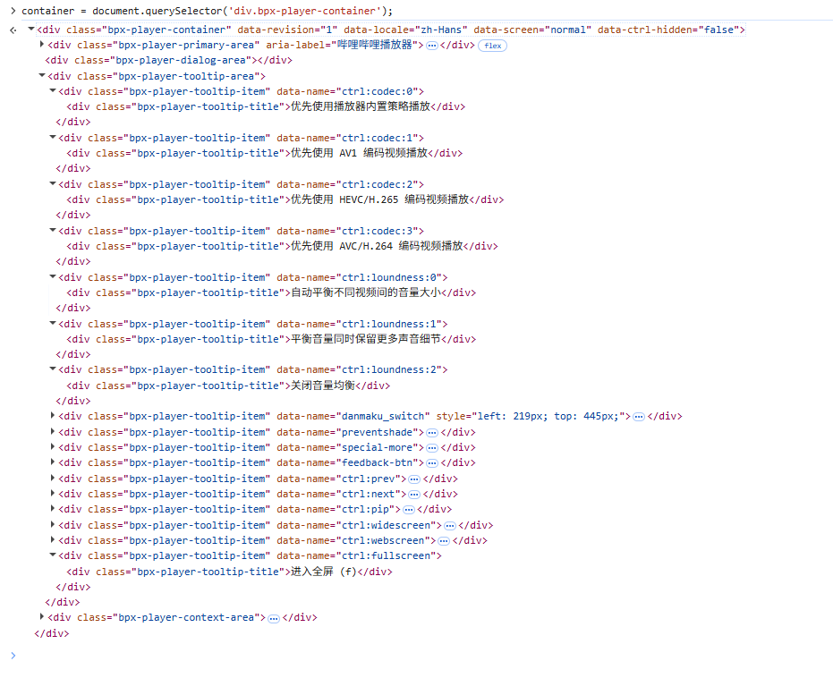

最近在看《Angel beats!》，但是我经常想要截图，首先首先用了Power Toys这个工具 + ShareX，让`Win+P`映射到`LAlt+PrintScreen`, 实现对当前focus屏幕的截屏。

后来我发现可以按d来切换弹幕的开关，这固然是很好的，只是会有几秒钟的时间悬浮“开启弹幕”/“关闭弹幕”之类的文字，影响我截图了！

这应该是前端行为，尝试进行去除.

### 0x01 定位Event listener
对在debugger中下Event Listener断点，选择`Keyboard`. 接着按下d, 触发了断点(通过观察，弹幕的开关是在按下的一瞬间发动的，排除KeyUp; 再独立实验可以发现负责捕获弹幕开关快捷键的是KeyDown Listener).

> **KeyPress, KeyDown, KeyUp**
> 
> KeyPress当按下字符键时触发（不包括控制按键）
> 
> KeyDown当按下任意字符时触发
> 
> KeyPress当松开任意按键时触发
{: .prompt=info }

```js
h.useEffect)( () => {
                var e = e => {
                    if (!((t = e.target && e.target.tagName) && ["input", "textarea", "select"].indexOf(t) >= 0) && (null === (a = e.target) || void 0 === a || !a.isContentEditable) && e.key) {
                        var t, a, l = e.key.toLowerCase();
                        i.indexOf(l) >= 0 && "" === o.current && (o.current = l,
                        r.current = window.setTimeout( () => {
                            r.current = null,
                            o.current && n.onStart(o.current)
                        }
                        , n.threshold))
                    }
                }
                  , t = e => {
                    o.current === e.key && (r.current && (n.onCancel(o.current),
                    clearTimeout(r.current),
                    r.current = null),
                    n.onFinish(o.current),
                    o.current = "")
                }
                ;
                return document.addEventListener("keyup", t),
                document.addEventListener("keydown", e),
                () => {
                    document.removeEventListener("keyup", t),
                    document.removeEventListener("keydown", e)
                }
            }
            ...
```

接着按几个Continue就会触发开关弹幕的效果. 但是目前这样的定位还太宽泛，需要继续向内减小范围.

**方法1**：观察到keylistener的最后一个断点（也就是出现悬浮文字前的一个断点）：

```js
i.shortcutHandler = function(t) {
                !t || !t.keyCode || this.mediaStore.video.controls || this.rootPlayer.disabled.shortcut || this.portStore.hasEditableFocus() || (this.shortcutKeysCombineShift(t),
                t.shiftKey || t.metaKey || t.altKey || t.ctrlKey || (this.portStore.hasFocus() && this.shortcutKeysInFocus(t),
                this.shortcutKeysGlobal(t)))
            }
```

进入`shortcutKeysGlobal`, 发现就是处理函数.

**方法2**：调试的时候发现KeyCode是68 (`D`), 全局搜索" 68"

```js
                case 68:
                    if (this.panoramaStore.shortcutPrior || this.danmakuStore.state.state)
                        return;
                    if (!this.keydownMap.get(_[i]).status) {
                        this.keydownMap.get(_[i]).status = !0;
                        var r = this.dmSettingStore.toggleDmSwitch()		// 猜测dm是“弹幕”的意思
                          , l = r !== T.cF.Closed;
                        this.shortcutTooltip("shortcut", l ? r === T.cF.Concise ? "精简弹幕" : "开启弹幕" : "关闭弹幕"),
                        this.track.e("shortcut_dmswitch", +!!l)
                    }
                    break;
```

**方法3**：全局搜索"开启弹幕"，“关闭弹幕”

同上.


按下快捷键后，通过`toggleDmSwitch`实现弹幕开关，而悬浮文字则是通过`shortcutTooltip`实现的.

### 0x02 分析悬浮文字逻辑

找 this.shortcutTooltip的定义.

```js
i.shortcutTooltip = function(t, e) {
	this.tooltipStore.remove(t),
	this.tooltipStore.create({
		name: t,
		title: e,
		target: this.nodes.videoArea,
		position: p.Zj.CenterCenter
	})
}
```

但是接下来找不到 `tooltipStore.create`的定义了.

我们可以借助控制台来查看。通过调试到特定位置，然后输入`this.tooltipStore`:

```
*r {rootStore: n, rootPlayer: n, nodes: {…}, track: n, dp: {…}, …}*

1. **assetStore**: r {rootStore: n, rootPlayer: n, nodes: {…}, track: n, dp: {…}, …}
2. **auxStore**: r {rootStore: n, rootPlayer: n, nodes: {…}, track: n, dp: {…}, …}
3. **blockStore**: r {rootStore: n, rootPlayer: n, nodes: {…}, track: n, dp: {…}, …}
......
50. **storyStore**: r {rootStore: n, rootPlayer: n, nodes: {…}, track: n, dp: {…}, …}
51. **subtitleStore**: r {rootStore: n, rootPlayer: n, nodes: {…}, track: n, dp: {…}, …}
52. **toastStore**: r {rootStore: n, rootPlayer: n, nodes: {…}, track: n, dp: {…}, …}
53. **tooltipStore**: r {rootStore: n, rootPlayer: n, nodes: {…}, track: n, dp: {…}, …}
54. **track**: n {queues: Array(0), toBeDefined: 'TBD', getRealtimeReportInfo: *ƒ*, reportSender: *ƒ*}
55. **trackStore**: r {rootStore: n, rootPlayer: n, nodes: {…}, track: n, dp: {…}, …}
56. **translationStore**: r {rootStore: n, rootPlayer: n, nodes: {…}, track: n, dp: {…}, …}
57. **uiStore**: r {rootStore: n, rootPlayer: n, nodes: {…}, track: n, dp: {…}, …}
58. **upStore**: r {rootStore: n, rootPlayer: n, nodes: {…}, track: n, dp: {…}, …}
59. **userStore**: r {rootStore: n, rootPlayer: n, nodes: {…}, track: n, dp: {…}, …}
60. **viewTrack**: r {rootStore: n, rootPlayer: n, nodes: {…}, track: n, dp: {…}, …}
61. **wmpStore**: r {rootStore: n, rootPlayer: n, nodes: {…}, track: n, dp: {…}, …}
62. **Symbol(mobx administration)**: n {target\_: r, values\_: Map(1), name\_: 'ObservableObject', defaultAnnotation\_: {…}, keysAtom\_: n, …}
63. **Symbol(mobx-stored-annotations)**: {}
64. defaultState: (...)
65. log: (...)
66. get records: *ƒ ()*
67. set records: *ƒ (r)*
68. [[Prototype]]: r
    1. **onDisconnect**: *ƒ ()*
    2. **tryStartTimerClock**: *ƒ (n)*
    3. **constructor**: *ƒ r(n)*
    4. **create**: *ƒ u()*
    5. **remove**: *ƒ u()*
    6. **update**: *ƒ u()*
    7. **Symbol(mobx-stored-annotations)**: {records: {…}, create: {…}, update: {…}, remove: {…}}
    8. defaultState: (...)
    9. log: (...)
    10. [[Prototype]]: n
        1. **changeState**: *ƒ (n,r)*
        2. **onCommitted**: *ƒ ()*
        3. **onDispose**: *ƒ (n)*
        4. **onGraphFlatten**: *ƒ ()*
        5. **onMount**: *ƒ ()*
        6. **onMounted**: *ƒ ()*
        7. **onNavigate**: *ƒ ()*
        8. **onPrepared**: *ƒ ()*
        9. **onStateCreate**: *ƒ ()*
        10. **onStateCreated**: *ƒ ()*
        11. **onStorageBuild**: *ƒ ()*
        12. **setState**: *ƒ (n,r)*
        13. **constructor**: *ƒ r(n)*
        14. **defaultState**: (...)
        15. log: (...)
        16. get defaultState: *ƒ ()*
        17. [[Prototype]]: Object
```

重要的是最后的`prototype: r`，可以看到这里方法中有`create`, `remove`, `update`等.

```
create : ƒ u() isMobxAction : true length : 0 name : "create" prototype : {} arguments : (...) caller : (...) [[FunctionLocation]] : VM41 core.8a3d87a9.js:1 [[Prototype]] : ƒ () [[Scopes]] : Scopes[6]
```

接着点击定位function location.

```js
 function ta(n, r, i, o) {
	function u() {
		return ts(n, i, r, o || this, arguments)
	}
	return void 0 === i && (i = !1),
	u.isMobxAction = !0,
	ti && (to.value = n,
	T(u, "name", to)),
	u
}
function ts(n, r, i, o, u) {
	var l = tu(n, r, o, u);
	try {
		return i.apply(o, u)
	} catch (n) {
		throw l.error_ = n,
		n
	} finally {
		tl(l)
	}
}
```

混淆的代码，追踪到后面就很难手工分析了.


> 或者用控制台方法：
> 
> 如果在控制台先输入一次`const ts = this.tooltipStore` (显示undefined正常，因为const赋值语句本来就会返回undefined),  但是下一次再输入ts会显示undefined, 是因为前面的ts作用域已经结束.
> 
> 可以用 `globalThis.ts = this.tooltipStore`， 可以在命令结束后不销毁`ts`的值
> 
> 输入`ts.create`，显示
> 
> ƒ u(){return ts(n,i,r,o||this,arguments)}
{: .prompt-tip }

ta是MobX action wrapper，AI说里面比较重要的是records,

```
n {name_: 'ObservableMap', data_: Map(18), hasMap_: Map(18), keysAtom_: n, enhancer_: ƒ, …}
changeListeners_: undefined
data_: Map(18) {'ctrl:codec:0' => r, 'ctrl:codec:1' => r, 'ctrl:codec:2' => r, 'ctrl:codec:3' => r, 'ctrl:longpress-rate:smart' => r, …}
dehancer: undefined
enhancer_: ƒ em(n,r,i)
hasMap_: Map(18) {'ctrl:codec:0' => r, 'ctrl:codec:1' => r, 'ctrl:codec:2' => r, 'ctrl:codec:3' => r, 'ctrl:longpress-rate:smart' => r, …}
interceptors_: undefined
keysAtom_: n {name_: 'ObservableMap.keys()', isPendingUnobservation_: false, isBeingObserved_: true, observers_: Set(1), diffValue_: 0, …}
name_: "ObservableMap"
Symbol(mobx administration): {}
size: (...)
Symbol(Symbol.toStringTag): (...)
[[Prototype]]: Object
```

在create的时候按下step over, 然后再次检查records，data_部分多了一个"shortcut",

```
changeListeners_: undefined
data_: Map(19)
[[Entries]]
0: {"ctrl:codec:0" => r}
1: {"ctrl:codec:1" => r}
2: {"ctrl:codec:2" => r}
3: {"ctrl:codec:3" => r}
4: {"ctrl:longpress-rate:smart" => r}
5: {"ctrl:loundness:0" => r}
6: {"ctrl:loundness:1" => r}
7: {"ctrl:loundness:2" => r}
8: {"danmaku_switch" => r}
9: {"preventshade" => r}
10: {"special-more" => r}
11: {"feedback-btn" => r}
12: {"ctrl:pip" => r}
13: {"ctrl:fullscreen" => r}
14: {"ctrl:prev" => r}
15: {"ctrl:next" => r}
16: {"ctrl:widescreen" => r}
17: {"ctrl:webscreen" => r}
18: {"shortcut" => r}
size: 19
[[Prototype]]: Map
dehancer: undefined
enhancer_: ƒ em(n,r,i)
hasMap_: Map(19) {'ctrl:codec:0' => r, 'ctrl:codec:1' => r, 'ctrl:codec:2' => r, 'ctrl:codec:3' => r, 'ctrl:longpress-rate:smart' => r, …}
interceptors_: undefined
keysAtom_: n {name_: 'ObservableMap.keys()', isPendingUnobservation_: false, isBeingObserved_: true, observers_: Set(1), diffValue_: 0, …}
name_: "ObservableMap"
Symbol(mobx administration): {}
size: (...)
Symbol(Symbol.toStringTag): (...)
[[Prototype]]: Object
```

重点看这个shortcut, 控制台输入 this.tooltipStore.records.get("shortcut"),

```
{…}
delay: 300
duration: 3000
gap: 6
name: "shortcut"
offsetX: 0
offsetY: 0
position: 5
renderGap: 8
renderTarget: div.bpx-player-tooltip-area
target: div.bpx-player-video-area
timeStamp: 1788073261429
timerClock: r
title: "开启弹幕"
Symbol(mobx administration): n {target_: {…}, values_: Map(13), name_: 'ObservableMap.key', defaultAnnotation_: {…}, keysAtom_: n, …}
get delay: ƒ ()
set delay: ƒ (r)
get duration: ƒ ()
set duration: ƒ (r)
get gap: ƒ ()
set gap: ƒ (r)
get name: ƒ ()
set name: ƒ (r)
......
get title: ƒ ()
set title: ƒ (r)
[[Prototype]]: Object
```

果然出现了“开启弹幕”文字.

### 0x03 编写油猴脚本进行屏蔽

要控制`this.shortcutTooltip`的行为，就要先找到这里的`this`是什么对象，追踪到它在DOM对应的元素.

在处理函数的开头位置，有`var e = this`. 不过经过查阅资料，js中的`this`并不是在定义时决定的，而是在运行时动态绑定的。也就是说，通常指向调用者对象.

```js
 i.shortcutKeysGlobal = function(t) {
                var e = this
                  , i = L[t.keyCode];
                switch (t.keyCode) {
                case 27:
                    ......
```

回到上一层，果然是通过`this.xxx`调用的. 而这个function又是通过`i.shortcutHandler`定义的，所以`this`指向`i`.

```js
i.shortcutHandler = function(t) {
                !t || !t.keyCode || this.mediaStore.video.controls || this.rootPlayer.disabled.shortcut || this.portStore.hasEditableFocus() || (this.shortcutKeysCombineShift(t),
                t.shiftKey || t.metaKey || t.altKey || t.ctrlKey || (this.portStore.hasFocus() && this.shortcutKeysInFocus(t),
                this.shortcutKeysGlobal(t)))
            }
```

继续找到`var i = e.prototype;`

```js
96561: function(t, e, i) {
        var n, a = i(5425), o = i(20341), s = i(42900), r = i(77380), l = i(34191), c = i(93045), h = i(85216), p = i(81851), d = i(10608), u = i.n(d), m = i(48711), f = i(92336), x = i.n(f), A = i(75540), g = i.n(A), y = i(76442), v = i.n(y), b = i(27017), k = i(74808), w = i(82343), S = i(22042), C = i(43827), E = i(15518), P = i(76239), B = i(64453), D = i(79788), T = ((n = T || {}).KeyF = "KeyF",
        n.KeyD = "KeyD",
        n.KeyM = "KeyM",
        n.KeyQ = "KeyQ",
        n.KeyW = "KeyW",
        n.KeyE = "KeyE",
        n.KeyR = "KeyR",
        n.Enter = "Enter",
        n.Space = "Space",
        n.Escape = "Escape",
        n.ArrowUp = "ArrowUp",
        n.ArrowDown = "ArrowDown",
        n.ArrowLeft = "ArrowLeft",
        n.ArrowRight = "ArrowRight",
        n.BracketLeft = "BracketLeft",
        n.BracketRight = "BracketRight",
        n.Shift1 = "Shift1",
        n.Shift2 = "Shift2",
        n.Digit1 = "Digit1",
        n.Digit2 = "Digit2",
        n.Digit3 = "Digit3",
        n.Digit4 = "Digit4",
        n.Tab = "Tab",
        n.KeyG = "KeyG",
        n), L = {
            49: "Digit1",
            50: "Digit2",
            51: "Digit3",
            52: "Digit4",
            70: "KeyF",
            68: "KeyD",
            77: "KeyM",
            81: "KeyQ",
            87: "KeyW",
            69: "KeyE",
            82: "KeyR",
            13: "Enter",
            32: "Space",
            27: "Escape",
            38: "ArrowUp",
            104: "ArrowUp",
            40: "ArrowDown",
            98: "ArrowDown",
            37: "ArrowLeft",
            100: "ArrowLeft",
            39: "ArrowRight",
            102: "ArrowRight",
            219: "BracketLeft",
            221: "BracketRight",
            Shift1: "Shift1",
            Shift2: "Shift2",
            9: "Tab",
            71: "KeyG"
        }, _ = p.rg.length, H = function(t) {
            function e() {
                var t;
                return (0,
                o._)(this, e),
                t = (0,
                a._)(this, e, arguments),
                t.threePlayrateActiveIndex = 0,
                t.threePlayrateCarouselPos = 1,
                t.threePlayrateRehome = null,
                t.threePlayrateRehomeTimer = 0,
                t.threePlayrateActive = !1,
                t.threePlayrateLastStepAt = 0,
                t.threePlayrateSessionRate = p.e_.Uninit,
                t.threePlayrateStepped = !1,
                t
            }
            (0,
            l._)(e, t);
            var i = e.prototype;
    ......
```

接着发现`96561: function(t, e, i)`的参数t需要进一步追踪... 这样追踪太慢了.

在查看stack的时候发现目标对象有下列属性：

```
container: "div.bpx-player-container"
```

这是一个css selector. 

控制台中输入`container = document.querySelector('div.bpx-player-container');`

得到：



可以看到里面有一个`bpx=player-tooltip-area`的元素，不断展开.

>**html, js, css的关联**
>
>浏览器加载html的时候，会维护一个树状结构 (DOM), 而css和js负责对DOM进行操作，实现修改html的功能.
>
>单独的`<div class="abc"/>`， `<div id="xyz"/>`并没有意义; 但是css/js可以操作这些元素.
>
>id是元素的唯一标识符，不能重复；而class则是按照功能设置的一个类似“tag”的功能，可以在多个元素中复用.
>
>```css
>.xyz {
>    color: blue;
>    font-size: 24px;
>}
>
>#abc {
>    ......
>}
>```
>
>```js
>document.getElementById('xyz')
>document.querySelector('#xyz')
>
>document.getElementsByClassName('abc')
>document.querySelectorAll('.abc')
>```
{: .prompt-info }

继续在stack中看，还可以发现它有一个`nodes`属性，这代表它课

```js
nodes = {
    advDanmaku: 'div.bpx-player-adv-dm-wrap',
    basDanmaku: 'div.bpx-player-bas-dm-wrap',
    bubble: 'div.bpx-player-ctrl-quality-bubble',
    buffIcon: 'div.bpx-player-state-buff-icon',
    buffSpeed: 'span.bpx-player-state-buff-speed',
    buffTitle: 'span.bpx-player-state-buff-title',
    businessWrap: 'div.bpx-player-business-wrap.business-hide',
    cmdDanmaku: 'div.bpx-player-cmd-dm-wrap',
    cmdInside: 'div.bpx-player-cmd-dm-inside',
    container: 'div.bpx-player-container',
    contextArea: 'div.bpx-player-context-area',
    controlBottomCenter: 'div.bpx-player-control-bottom-center',
    controlBottomLeft: 'div.bpx-player-control-bottom-left',
    controlBottomRight: 'div.bpx-player-control-bottom-right',
    controlEntity: 'div.bpx-player-control-entity',
    controlTop: 'div.bpx-player-control-top',
    controlWrap: 'div.bpx-player-control-wrap',
    customListPanelContainer: 'div.bpx-player-ctrl-eplist-menu-wrap',
    danmakuArea: 'div.bpx-player-render-dm-wrap',
    dialogArea: 'div.bpx-player-dialog-area',
    dialogWrap: 'div.bpx-player-dialog-wrap',
    dmMaskWrap: 'div.bpx-player-dm-mask-wrap',
    dmReportWrap: 'div.bpx-player-dm-report-wrap',
    dmSvgMaskWrap: 'div.bpx-player-dm-svg-mask-wrap',
    endingPanel: 'div.bpx-player-ending-panel',
    endingWrap: 'div.bpx-player-ending-wrap',
    loadingPanel: 'div.bpx-player-loading-panel',
    musicWrap: 'div.bpx-player-music-wrap',
    newDialogueArea: 'div.bpx-player-new-dialogue-area',
    rowDanmaku: 'div.bpx-player-row-dm-wrap',
    sendingArea: 'div.bpx-player-sending-area',
    sendingBar: 'div.bpx-player-sending-bar',
    sharePanel: 'div.bpx-player-share-panel',
    stateWrap: 'div.bpx-player-state-wrap',
    subtitleWrap: 'div.bpx-player-subtitle-wrap',
    summaryWrap: 'div.bpx-player-summary-wrap',
    toastAuto: 'div.bpx-player-toast-auto',
    toastFixed: 'div.bpx-player-toast-fixed',
    toastWrap: 'div.bpx-player-toast-wrap',
    tooltipArea: 'div.bpx-player-tooltip-area',
    topFollow: 'div.bpx-player-top-follow',
    topLeftFollow: 'div.bpx-player-top-left-follow',
    topLeftMusic: 'div.bpx-player-top-left-music',
    topLeftPanoram: 'div.bpx-player-top-left-panorama',
    topLeftTitle: 'div.bpx-player-top-left-title',
    topTitle: 'div.bpx-player-top-title',
    topWrap: 'div.bpx-player-top-wrap',
    videoArea: 'div.bpx-player-video-area',
    videoPerch: 'div.bpx-player-video-perch',
    videoPoster: 'div.bpx-player-video-poster',
    videoWrap: 'div.bpx-player-video-wrap'
};
```


AI查找相关资料，从DOM层能确定最终屏蔽的对象是`.bpx-player-tooltip-area`
```
playTooltipArea:  '.bpx-player-tooltip-area'
playTooltipItem:  '.bpx-player-tooltip-item'
playTooltipTitle: '.bpx-player-tooltip-title'
```

tempmonkey
```js
// ==UserScript==
// @name         Bilibili 隐藏弹幕快捷键提示
// @match        https://www.bilibili.com/video/*
// @run-at       document-start
// @grant        none
// ==/UserScript==

(() => {
    'use strict';

    const blockedTexts = new Set([
        '开启弹幕',
        '关闭弹幕',
        '精简弹幕',
    ]);

    const hideTooltip = (root) => {
        // root 本身也可能就是 title
        const titles = [];

        if (root instanceof Element &&
            root.matches('.bpx-player-tooltip-title')) {
            titles.push(root);
        }

        if (root instanceof Element || root instanceof Document) {
            titles.push(
                ...root.querySelectorAll('.bpx-player-tooltip-title')
            );
        }

        for (const title of titles) {
            if (!blockedTexts.has(title.textContent.trim())) {
                continue;
            }

            const item = title.closest('.bpx-player-tooltip-item');

            if (item) {
                item.style.setProperty('display', 'none', 'important');
            }
        }
    };

    const observer = new MutationObserver(records => {
        for (const record of records) {
            for (const node of record.addedNodes) {
                if (node.nodeType === Node.ELEMENT_NODE) {
                    hideTooltip(node);
                }
            }

            if (record.type === 'characterData') {
                const parent = record.target.parentElement;
                if (parent) {
                    hideTooltip(parent);
                }
            }
        }
    });

    observer.observe(document.documentElement, {
        childList: true,
        subtree: true,
        characterData: true,
    });
})();
```
无效.

新版的也无效：
```js
// ==UserScript==
// @name         Bilibili 隐藏弹幕快捷键提示
// @namespace    http://tampermonkey.net/
// @description  Don't show floated tips when using "d" in bilibili
// @version      AngelBeats!
// @match        https://www.bilibili.com/*
// @run-at       document-start
// @grant        none
// ==/UserScript==

(() => {
    'use strict';

    const blockedTexts = new Set([
        '开启弹幕',
        '关闭弹幕',
        '精简弹幕',
    ]);

    function checkTitle(title) {
        if (!title?.matches?.('.bpx-player-tooltip-title')) {
            return;
        }

        const item = title.closest('.bpx-player-tooltip-item');
        if (!item) {
            return;
        }

        const blocked = blockedTexts.has(title.textContent.trim());

        if (blocked) {
            item.style.setProperty('display', 'none', 'important');
        } else {
            // Bilibili 可能复用同一个 tooltip-item，
            // 所以显示其他提示时要撤掉我们加的 display:none。
            if (item.style.getPropertyPriority('display') === 'important' &&
                item.style.display === 'none') {
                item.style.removeProperty('display');
            }
        }
    }

    function checkNode(node) {
        if (!(node instanceof Element)) {
            return;
        }

        if (node.matches('.bpx-player-tooltip-title')) {
            checkTitle(node);
        }

        for (const title of node.querySelectorAll('.bpx-player-tooltip-title')) {
            checkTitle(title);
        }
    }

    function start() {
        // 先处理已经存在的节点
        for (const title of document.querySelectorAll('.bpx-player-tooltip-title')) {
            checkTitle(title);
        }

        const observer = new MutationObserver(records => {
            for (const record of records) {

                // 关键：
                // textContent = "开启弹幕" 往往表现为
                // title 元素内部 Text Node 被替换。
                //
                // 所以检查 record.target，而不仅仅是 addedNodes。
                if (record.target instanceof Element) {
                    checkNode(record.target);
                }

                // 同时处理真正新增的 tooltip DOM
                for (const node of record.addedNodes) {
                    if (node instanceof Element) {
                        checkNode(node);
                    }
                }
            }
        });

        observer.observe(document.documentElement, {
            childList: true,
            subtree: true,
            characterData: true,
        });
    }

    if (document.documentElement) {
        start();
    } else {
        new MutationObserver((_, observer) => {
            if (document.documentElement) {
                observer.disconnect();
                start();
            }
        }).observe(document, {
            childList: true,
        });
    }
})();
```


ver2: 直接隐藏，也无效:
```js
// ==UserScript==
// @name         Bilibili 隐藏 D 键弹幕提示
// @namespace    http://tampermonkey.net/
// @description  Hide danmaku shortcut tooltip when pressing D
// @version      1.0
// @match        https://www.bilibili.com/*
// @run-at       document-start
// @grant        none
// ==/UserScript==

(() => {
    'use strict';

    const style = document.createElement('style');

    style.textContent = `
        html.tm-hide-danmaku-tip
        .bpx-player-tooltip-item[data-name="shortcut"] {
            display: none !important;
            visibility: hidden !important;
            opacity: 0 !important;
        }
    `;

    (document.head || document.documentElement).appendChild(style);

    let timer = null;

    window.addEventListener('keydown', e => {
        if (
            e.code !== 'KeyD' &&
            e.key?.toLowerCase() !== 'd'
        ) {
            return;
        }

        document.documentElement.classList.add(
            'tm-hide-danmaku-tip'
        );

        clearTimeout(timer);

        // Bilibili 的 shortcut tooltip 会存在一段时间，
        // 在这期间直接通过 CSS 禁止显示。
        timer = setTimeout(() => {
            document.documentElement.classList.remove(
                'tm-hide-danmaku-tip'
            );
        }, 2500);
    }, true);
})();
```

最后发现script根本没有执行，原因是需要提前在chrome://extension -> tempmonkey -> detail中勾选allow user script.


```js
// ==UserScript==
// @name         Bilibili 隐藏弹幕快捷键提示
// @namespace    http://tampermonkey.net/
// @description  Don't show floated tips when using "d" in bilibili
// @version      AngelBeats!
// @match        https://www.bilibili.com/*
// @run-at       document-start
// @grant        none
// ==/UserScript==

(() => {
    'use strict';

    const blockedTexts = new Set([
        '开启弹幕',
        '关闭弹幕',
        '精简弹幕',
    ]);

    function checkTitle(title) {
        if (!title?.matches?.('.bpx-player-tooltip-title')) {
            return;
        }

        const item = title.closest('.bpx-player-tooltip-item');
        if (!item) {
            return;
        }

        const blocked = blockedTexts.has(title.textContent.trim());

        if (blocked) {
            item.style.setProperty('display', 'none', 'important');
        } else {
            // Bilibili 可能复用同一个 tooltip-item，
            // 所以显示其他提示时要撤掉我们加的 display:none。
            if (item.style.getPropertyPriority('display') === 'important' &&
                item.style.display === 'none') {
                item.style.removeProperty('display');
            }
        }
    }

    function checkNode(node) {
        if (!(node instanceof Element)) {
            return;
        }

        if (node.matches('.bpx-player-tooltip-title')) {
            checkTitle(node);
        }

        for (const title of node.querySelectorAll('.bpx-player-tooltip-title')) {
            checkTitle(title);
        }
    }

    function start() {
        // 先处理已经存在的节点
        for (const title of document.querySelectorAll('.bpx-player-tooltip-title')) {
            checkTitle(title);
        }

        const observer = new MutationObserver(records => {
            for (const record of records) {

                // 关键：
                // textContent = "开启弹幕" 往往表现为
                // title 元素内部 Text Node 被替换。
                //
                // 所以检查 record.target，而不仅仅是 addedNodes。
                if (record.target instanceof Element) {
                    checkNode(record.target);
                }

                // 同时处理真正新增的 tooltip DOM
                for (const node of record.addedNodes) {
                    if (node instanceof Element) {
                        checkNode(node);
                    }
                }
            }
        });

        observer.observe(document.documentElement, {
            childList: true,
            subtree: true,
            characterData: true,
        });
    }

    if (document.documentElement) {
        start();
    } else {
        new MutationObserver((_, observer) => {
            if (document.documentElement) {
                observer.disconnect();
                start();
            }
        }).observe(document, {
            childList: true,
        });
    }
})();
```