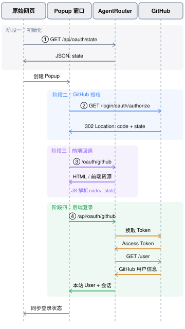

最近刚刚发现agentrouter之类的公益站竟然能签到白嫖api额度，这样跑实验就不用花自己的了.

### AgentRouter

agentrouter的签到在重新登录的过程中即可触发.

#### github登录的机制

1. 点击login with github后的第一次交互
开启控制台，logout后点击“github登录”,会弹出一个新的页面(跳转到AgentRouter首页), 可以抓到一个包:

```
# request general
Request URL: https://agentrouter.org/api/oauth/state?mode=login
Request method: GET
Status code: 200 OK
Remote address: 8.214.160.125:443
Referrer policy: strict-origin-when-cross-origin

# request header
HTTP/1.1 200 OK
Date: Wed, 25 Nov 2026 09:53:15 GMT
Content-Type: application/json; charset=utf-8
Content-Length: 182
Connection: keep-alive
Content-Encoding: gzip
Request-Id: 20261125175315426877340lh28gMbhGQFWI
Set-Cookie: session=MTc5NTYwMDM5NXxEWDhFQVFMX2dBQUJFQUVRQUFEX3JfLUFBQUVHYzNSeWFXNW5EQTBBQzI5aGRYUm9YM04wWVhSbEJuTjBjbWx1Wnd6X2l3RF9pR1Y1U25WSmFtOXBVbnBPVFZkRVNUVldSMnhDV1dwQk0wbHBkMmxpVTBrMlNXMTRkbG95YkhWSmFYZHBaRk5KTmsxRGQybGFVMGsyVFZSak5VNVVXWGROUkdzMVRsZ3dMakUwTm1Zd09UTmtZems1Tm1NMU1XTmxPREF5T0dGaU5HSTFNR013TURFeFpUTXhNemhoT0RkaU5qQTRNV1prTjJWaE9HWTFZelUyWkRZMU5qQXhORFU9fPBc-p-UY-8rTPCVIEktPOwrKcXFhqStJzT5MrS_9vwT; Path=/; Expires=Fri, 25 Dec 2026 09:53:15 GMT; Max-Age=2592000; HttpOnly; SameSite=Strict
Vary: Accept-Encoding
X-Oneapi-Request-Id: 20261125175315426877340lh28gMbhGQFWI

# request payload
mode=login
```

可以推测出`/api/oauth/state`是agentrouter后端的一个api.

> general中的GET部分表示网站访问了哪个url. 它是以Host为基础的，也就是https://agentrouter.org/api/oauth/state
> 
> payload表示向服务器发送的数据，可能以参数形式传递（这里就是），也可能放在request payload中.
> 
> preview和response都是服务器端返回的数据.
{: .prompt-tip}

```
# response header
HTTP/1.1 200 OK
Date: Wed, 25 Nov 2026 09:53:15 GMT
Content-Type: application/json; charset=utf-8
Content-Length: 182
Connection: keep-alive
Content-Encoding: gzip
Request-Id: 20261125175315426877340lh28gMbhGQFWI
Set-Cookie: session=MTc5NTYwMDM5NXxEWDhFQVFMX2dBQUJFQUVRQUFEX3JfLUFBQUVHYzNSeWFXNW5EQTBBQzI5aGRYUm9YM04wWVhSbEJuTjBjbWx1Wnd6X2l3RF9pR1Y1U25WSmFtOXBVbnBPVFZkRVNUVldSMnhDV1dwQk0wbHBkMmxpVTBrMlNXMTRkbG95YkhWSmFYZHBaRk5KTmsxRGQybGFVMGsyVFZSak5VNVVXWGROUkdzMVRsZ3dMakUwTm1Zd09UTmtZems1Tm1NMU1XTmxPREF5T0dGaU5HSTFNR013TURFeFpUTXhNemhoT0RkaU5qQTRNV1prTjJWaE9HWTFZelUyWkRZMU5qQXhORFU9fPBc-p-UY-8rTPCVIEktPOwrKcXFhqStJzT5MrS_9vwT; Path=/; Expires=Fri, 25 Dec 2026 09:53:15 GMT; Max-Age=2592000; HttpOnly; SameSite=Strict
Vary: Accept-Encoding
X-Oneapi-Request-Id: 20261125175315426877340lh28gMbhGQFWI

# response payload
{
    "data": "eyJuIjoiWWJmSUJXNXkxS29iIiwibSI6ImxvZ2luIiwidSI6MCwiZSI6MTc5NTU5MTU1NH0.7540f3b4f2588a5f856e241a0adc411a0d3d1071309c11d71cbbc08a5be1f666",
    "message": "",
    "success": true
}
```

后端返回了data等数据

我们把data字段的前半部分b64解码：

```
{"n":"YbfIBW5y1Kob","m":"login","u":0,"e":1795591554}
```

目前的交互还只发生在agentrouter的前后端，并没有触及github（在弹出的新网页中进行github授权），那么访问`https://agentrouter.org/api/oauth/state`和弹出登录成功的新页面是怎么进行的呢？

很可能是在agentrouter获得了response后，前端的js页面根据response来调用了`window.open()`函数.

控制台输入下列内容：
```js
const originalOpen = window.open;

window.open = function (...args) {
    debugger;
    return originalOpen.apply(this, args);
};
```

接着能够找到

```js
async function v7(t, e="login") {
    const r = await b7(e);
    r && (localStorage.setItem("oauth_mode", e),
    window.open(`https://github.com/login/oauth/authorize?client_id=${t}&state=${r}&scope=user:email`))
}
```

接着来调试这个新弹出的页面.

> **抓取新页面的第一个包**
>
> 如果我们在弹出页面后再按f12就会错过抓包时机，所以需要修改控制台设置，让弹出新页面的时候自动开启控制台调试. (f12 -> f1 -> preference -> global -> Auto-open DevTools for popups, 注意在跳转前的页面控制台需要先打开，然后弹出的页面也会自动打开控制台)
{: .prompt-tip}

2. 新页面的第一个包

```
# request general 
Request URL: https://github.com/login/oauth/authorize?client_id=Ov23lidtiR4LeVZvVRNL&state=eyJuIjoiRzNMWDI5VGlBYjA3IiwibSI6ImxvZ2luIiwidSI6MCwiZSI6MTc5NTYwMDk5NX0.146f093dc996c51ce8028ab4b50c0011e3138a87b6081fd7ea8f5c56d6560145&scope=user:email
Request method: GET
Status code: 302 Found
Remote address: 140.82.114.4:443
Referrer policy: strict-origin-when-cross-origin

# request header
:authority: github.com
:method: GET
:path: /login/oauth/authorize?client_id=Ov23lidtiR4LeVZvVRNL&state=eyJuIjoiRzNMWDI5VGlBYjA3IiwibSI6ImxvZ2luIiwidSI6MCwiZSI6MTc5NTYwMDk5NX0.146f093dc996c51ce8028ab4b50c0011e3138a87b6081fd7ea8f5c56d6560145&scope=user:email
:scheme: https
......
priority: u=0, i
referer: https://agentrouter.org/
......


# request payload
client_id: Ov23lidtiR4LeVZvVRNL
state: eyJuIjoiRzNMWDI5VGlBYjA3IiwibSI6ImxvZ2luIiwidSI6MCwiZSI6MTc5NTYwMDk5NX0.146f093dc996c51ce8028ab4b50c0011e3138a87b6081fd7ea8f5c56d6560145
scope: user:email
```

agentrouter前端访问github的oauth接口. 各个参数意义如下：

client_id	AgentRouter 在 GitHub 注册的 OAuth 应用 ID
state	AgentRouter 生成的授权流程验证参数
scope=user:email	申请读取 GitHub 用户邮箱的权限

接着看github返回的response:

```
# response header
......
content-type: text/html; charset=utf-8
date: Wed, 25 Nov 2026 09:53:19 GMT
location: https://agentrouter.org/oauth/github?code=eb55d458005a09c42f30&iss=https%3A%2F%2Fgithub.com%2Flogin%2Foauth&state=eyJuIjoiRzNMWDI5VGlBYjA3IiwibSI6ImxvZ2luIiwidSI6MCwiZSI6MTc5NTYwMDk5NX0.146f093dc996c51ce8028ab4b50c0011e3138a87b6081fd7ea8f5c56d6560145
referrer-policy: origin-when-cross-origin, strict-origin-when-cross-origin
server: github.com
......

# 没有response payload
```

github返回的response中，把关键信息放在了header中的location字段，而不是payload中.

location中存放了一个重定向url, 包含github返回的code.


3. 新页面的第二个包

```
# request general
Request URL: https://agentrouter.org/oauth/github?code=eb55d458005a09c42f30&iss=https%3A%2F%2Fgithub.com%2Flogin%2Foauth&state=eyJuIjoiRzNMWDI5VGlBYjA3IiwibSI6ImxvZ2luIiwidSI6MCwiZSI6MTc5NTYwMDk5NX0.146f093dc996c51ce8028ab4b50c0011e3138a87b6081fd7ea8f5c56d6560145
Request method: GET
Status code: 200 OK
Remote address: 8.214.160.125:443
Referrer policy: strict-origin-when-cross-origin

# request header
GET /oauth/github?code=eb55d458005a09c42f30&iss=https%3A%2F%2Fgithub.com%2Flogin%2Foauth&state=eyJuIjoiRzNMWDI5VGlBYjA3IiwibSI6ImxvZ2luIiwidSI6MCwiZSI6MTc5NTYwMDk5NX0.146f093dc996c51ce8028ab4b50c0011e3138a87b6081fd7ea8f5c56d6560145 HTTP/1.1
...
Host: agentrouter.org
Referer: https://agentrouter.org/
...
```

```
# response header
HTTP/1.1 200 OK
Date: Wed, 25 Nov 2026 09:53:19 GMT
Content-Type: text/html; charset=utf-8
Content-Length: 782
Connection: keep-alive
Cache-Control: no-cache
Content-Encoding: gzip
Request-Id: 20261125175319958932599p2cgpEXMGBOxY
Vary: Accept-Encoding
X-Oneapi-Request-Id: 20261125175319958932599p2cgpEXMGBOxY
```

这次的访问是由前一个包中的location字段导致的. 这个前端的url `/oauth/github`很可能是为了解析github的code、state等字段，为后续做准备. 所以它没有response也很合理.

4. 新页面的第三个包

```
# request header
GET /api/oauth/github?code=eb55d458005a09c42f30&state=eyJuIjoiRzNMWDI5VGlBYjA3IiwibSI6ImxvZ2luIiwidSI6MCwiZSI6MTc5NTYwMDk5NX0.146f093dc996c51ce8028ab4b50c0011e3138a87b6081fd7ea8f5c56d6560145&mode=login HTTP/1.1
...
Host: agentrouter.org
New-API-User: -1
Referer: https://agentrouter.org/oauth/github?code=eb55d458005a09c42f30&iss=https%3A%2F%2Fgithub.com%2Flogin%2Foauth&state=eyJuIjoiRzNMWDI5VGlBYjA3IiwibSI6ImxvZ2luIiwidSI6MCwiZSI6MTc5NTYwMDk5NX0.146f093dc996c51ce8028ab4b50c0011e3138a87b6081fd7ea8f5c56d6560145
...
```

在上一步后，前端对github返回的内容进行了一些基本处理. 这一次前端向后端请求了`/api/oauth/github` （注意和上一个的url不一样，以/api开头的是agentrouter的后端url）

```
# response header
data: {id: 821437, username: "github_821436", password: "", original_password: "", display_name: "9vvert",…}
message: ""
success: true
```

而这次后端成功返回了用户信息.


5. 总结

当我们点击"login with github"的时候，发生的是1，即前端会向后端api请求一个state,然后前端跳转到新页面.

新页面中，首先会发生2的过程，前端向github鉴权接口发包，github把关键信息以一个重定向url的形式返回.

3中，前端重定向到这个url (也是前端url)，负责解析.

4用解析后的数据，向后端发起请求（最重要的是github给的code字段）,后端会用这个临时code先获得access_token, 进而获得用户数据. 这些操作都在后端进行，因此前端无从得知. 最后后端返回用户信息.




### 百度贴吧


network -> application -> cookie下面可以看到网页的cookie. (但只显示当前网页上下文的cookie)

1. 人机验证和什么有关？

完成人机验证后，再次访问网站，不会重新要求验证.

是远程存储了机器的信息？还是本地的浏览器一些字段存储了一些有效的值？

用incognito window访问，又需要验证，很可能是本地字段.


观察cookie: 退出登录有，BDUSS等字段消失了(登录凭证)

探索免人机验证的信息存放在哪个字段：
删掉该网站的Local Storage/ Session Storage/Cookie, 仍然不需要登录；

但是在Application -> 左侧Application -> Storage全部删掉，就需要登录了. 这里面包括Cache Storage, Unregistered Service Workers, IndexedDB, Cookies, Local and Session Storage.


后来发现只是时间问题，在删除cookie后，等一会儿会重新生产BAIDUID和BAIDUID_BFESS两个值，如果在这两个值生成之前重新访问页面，就会触发重新验证.

如何调试一个storage变量的写入？比如我们发现的BAIDUID.

cookie通常可以通过本地(document.cookie)写入，也可以通过服务器端设置.

检查BAIDUID的值，并没有http only的属性. 所以本地恢复cookie是可能的


(1)是否是通过远程写入的？
, 清除cookie后，用鼠标滚轮滑动几下，发现两个值被恢复. 接着network -> filter中搜索set-cookie-name, 并没有，排除


(2)本地document.cookie写入？
document.cookie


并没有停下来.


(3)本地CookieStore写入？


排除

(4)新的角度
远程并不一定用set-cookie-name来设置.

将network中的no throttling(不限制网络) 改成offline, 然后再删除cookie, 发现不会恢复，那么就是通过远程来写入的.


检查network中的包 -> initiator，可以查看埋点


用codex + devtools mcp来分析，最后找到了.

在network中用`has-response-header:set-cookie`过滤，最后的数据是存放在response header中的


codex抓到的set-cookie包，但是我自己调试的时候却显示no reponse header. 

```
200 OK 说明 Chrome 已收到 HTTP 响应。结合这条请求的特征，最符合现有证据的解释是 Chrome 的 ORB/CORB 把交给渲染层的响应清空了。

本次记录里，这条请求具有：

请求：跨源 Beacon，Sec-Fetch-Mode: no-cors
响应：Content-Type: application/json

tieba.baidu.com 和 h2tcbox.baidu.com 属于同站跨源。Chrome 的 ORB/CORB 会检查这类响应；源码中的处理路径可以清空响应头、替换为空正文，同时保留 HTTP 状态码。Chromium 实现、机制说明

这与我抓到的两份记录吻合：

| 观察位置                                 | 结果                               |
| ---------------------------------------- | ---------------------------------- |
| 普通 Network.responseReceived            | 200，headers: {}                   |
| 网络层 Network.responseReceivedExtraInfo | 200，完整原始响应头，含 Set-Cookie |

所以，响应头没有显示出来，仍可能已经被浏览器网络层用于设置 Cookie。本次原始记录 (/tmp/baidu-cookie-investigation/beacon-capture.json)

我之前只解释“sendBeacon 没有响应回调”不够准确：那只能解释页面 JS 拿不到响应，不能直接解释 Network 面板里的响应头空白。

不过，ORB 是根据现有记录和源码作出的判断，尚未直接验证你那次请求；标准 DevTools 也会尝试合并额外响应信息。要确定你那次为什么没显示，需要监听同一请求的 Network.responseReceivedExtraInfo，按 requestId 对照，不能仅凭 200 OK 就完全定因。
```

为什么chrome会设计ORB?


### TODO

mitmproxy和证书